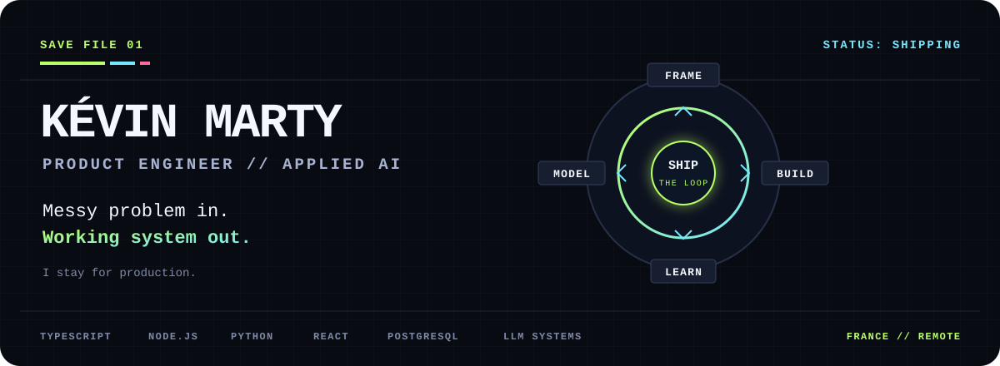

I turn ambiguous product problems into systems people can actually use - then stay around for production.

My path went from **solo builder**, to **First Engineer**, to **CTPO**, and back to the deeply hands-on work I enjoy most. I work across product decisions, interfaces, backend systems, Applied AI and infrastructure without treating any of them as somebody else's problem.

### `> SELECT A RUN`

| Run | The hard part | What shipped |
| --- | --- | --- |
| **MagicPost** | Making AI useful beyond the prompt | Production LLM pipelines, retrieval, evaluation, multi-model routing and a FastMCP server exposing **30+ authenticated product capabilities** |
| **[SideQuest](https://getsidequest.fr/)** | Turning fragmented game data and noisy listings into collector trust | Multi-source catalog, barcode and box OCR, edition matching and marketplace monitoring across React Native, Next.js, FastAPI and Supabase |
| **MateMaker** | Taking a consumer product through the full 0-to-1 loop | A gaming matchmaking app built solo to **10,000 registered users** and **2,300 monthly active users** |
| **LIGHT** | Growing from the first product to company-level ownership | First Engineer to CTPO, **three production products**, and a **seven-person product and engineering team** |

### `> BUILD LOOP`

```text
FRAME THE REAL CONSTRAINT  ->  MODEL THE SYSTEM  ->  SHIP THE LOOP
            ^                                            |
            +------------- OBSERVE PRODUCTION <----------+
```

**Main loadout:** TypeScript, Node.js, React, React Native, Python, PostgreSQL, Supabase, FastAPI, cloud infrastructure and LLM systems.

I choose boring, reliable tools when they fit. I go deeper when the product constraint earns the complexity.

### `> HUMAN IN THE LOOP`

Dad, lifelong gamer and collector of physical games. I like systems with rules you can explain, products with feedback loops you can measure, and teams with high standards but low ego.

**[Run the interactive portfolio](https://kevin-marty-portfolio.vercel.app/)** · **[Résumé](https://kevin-marty-portfolio.vercel.app/cv/cv-kevin-marty-en.pdf)** · **[LinkedIn](https://www.linkedin.com/in/kevin-marty)** · **[Email](mailto:kevin.marty@epitech.eu)**
